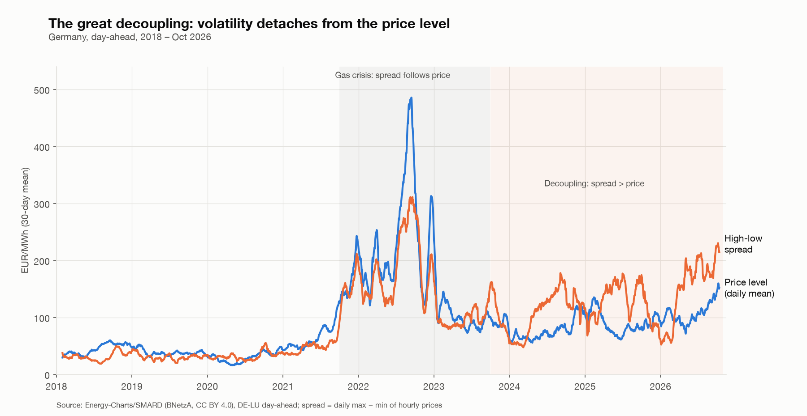

# The Great Decoupling – a reconstruction (Germany, 2018 – Oct 2026)

Reproduction and extension of the FlexPower analysis **"Die große Abkopplung" / "The Great Decoupling"** on German day-ahead prices: the daily high–low price spread (HL, a proxy for intraday volatility) used to move with the price *level* and has decoupled from it since 2024. This repo rebuilds the series from open data, checks it against the dataset behind the original chart, and extends it to October 2026 with a seasonal breakdown.

> **Reference:** Joas, A. (2025-02-07). *Die große Abkopplung* [blog post]. FlexPower. <https://flex-power.energy/de/energieblog/die-grosse-abkopplung/> (English: <https://flex-power.energy/energyblog/the-great-decoupling/>).
> This is an independent reconstruction; it is not affiliated with or endorsed by FlexPower.

## Key findings
1. **Reproduced.** Daily-spread and price level (30-day averages) move together from 2018 to 2023 (rolling 365-day correlation ≈ 0.9 during the 2021–23 gas crisis) and separate from 2024 on; in 2025 the correlation is negative (≈ −0.7).
2. **Decoupling is a solar-season effect.** HL ÷ price level by season:

   | Period | Winter (Nov–Feb) | Shoulder (Mar/Apr, Sep/Oct) | Summer (May–Aug) |
   |---|---|---|---|
   | 2018–20 | 0.83 | 0.98 | 0.73 |
   | 2021–22 | 0.82 | 0.89 | 0.72 |
   | 2023 | 0.80 | 1.13 | 1.16 |
   | 2024–26 | **0.82** | **1.61** | **1.80** |

   In winter the spread still tracks the (gas-driven) price; in summer and shoulder months it is ~1.6–1.8× the price level. The average summer price stays at ≈ 85 EUR/MWh while the spread grows from ≈ 27 to ≈ 154 EUR/MWh (2018–20 vs. 2024–26).
3. **Mechanism.** Summer 2025: midday price ≈ 7 EUR/MWh (solar) vs. evening peak ≈ 143 EUR/MWh (gas-set) – see `results/figures/05_hourly_profile.png`.
4. **Seasonal *and* structural.** The winter drop in HL is seasonal, but the year-on-year rise of summer spreads is structural. Caveat: only two winters (2024/25, 2025/26) are observed after the break.



More figures: `results/figures/en_02…05` (English) and `01…05` (German).

## Method
- Data: DE-LU day-ahead prices (DE-AT-LU before 2018-10-01), hourly (15-min since Oct 2025, averaged to hours). Source: [Energy-Charts](https://api.energy-charts.info/) / Bundesnetzagentur | SMARD.de, **CC BY 4.0**.
- Definitions (the post does not state them exactly – these are my assumptions): **HL** = daily maximum − daily minimum of hourly prices (Europe/Berlin day, ≥ 23 hours); **price level** = daily mean; both smoothed with a 30-day moving average.
- Cross-check: against the daily DE series of the FlexPower dataset (2020-01-01 – 2024-06-30), 1,642 of 1,643 days agree within 0.5 EUR/MWh; the single exception (2024-06-26, HL 2,325.89 in that file vs. 57.85 here) looks like a data error in the file. That dataset was shared privately and is **not** included (`data/external/` is git-ignored); `src/compare_flexpower.py` re-runs the check if you have it.

## Reproduce
```bash
pip install -r requirements.txt
python src/fetch.py          # downloads prices -> data/raw/ (rate-limited API, takes a few minutes)
python src/analyze.py        # daily/yearly series -> results/
python src/season_ratio.py   # seasonal table
python src/viz.py            # German figures;  python src/viz_en.py for English
```
`fetch.py` downloads DE-LU only; the DE-AT-LU part for 2018-01…09 was added once via `bzn=DE-AT-LU` (see the note at the end of that script) and is already contained in the committed CSV.

## Layout
```
data/raw/        prices (CC BY 4.0, attribution above)       data/README.md
src/             fetch, analyze, season_ratio, viz, viz_en, compare_flexpower
results/         daily.csv, yearly.csv, season_ratio.csv, figures/
```

## Limitations / next steps
HL definition assumed; no attribution to gas price, residual load or renewable share yet (planned: regression HL ~ gas, RES share, residual load); Germany only – FR, AT, NL and GB are in the FlexPower file but not reconstructed here.

## Licence
Code: MIT (see `LICENSE`). Price data: CC BY 4.0, © Bundesnetzagentur | SMARD.de via Energy-Charts.
